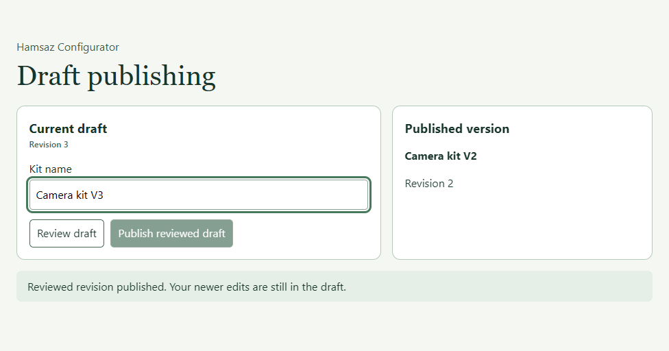

# Hamsaz Draft Publishing

A review that finishes late should never approve a newer draft. This React and TypeScript sample adapts the publication flow from **Hamsaz 0.1.0**, using a delayed in-memory API to show how the editor preserves newer changes.

## Interface preview

  
   
  <em>Revision 3 remains editable while the reviewed revision 2 is published</em>

## Run the demo

[Open the live demo](https://aa71200.github.io/hamsaz-editor-publish/)

To run the browser regression suite locally, install Chromium with `npx playwright install chromium`, then run `npm run test:browser` after `npm ci`.

1. Install dependencies with `npm ci`, then run `npm run dev` and open the local URL it prints.
2. Edit a kit name while review is pending. The outdated review must not enable publishing.
3. Review the updated draft, start publishing, and make another edit. The reviewed revision appears in **Published version**, with the newest edit still shown under **Current draft**.

`npm run build` typechecks the code and creates the static demo. [The editor](src/editor.tsx) documents the original snapshot and reviewed-revision logic and the test adapter. [License](LICENSE).
